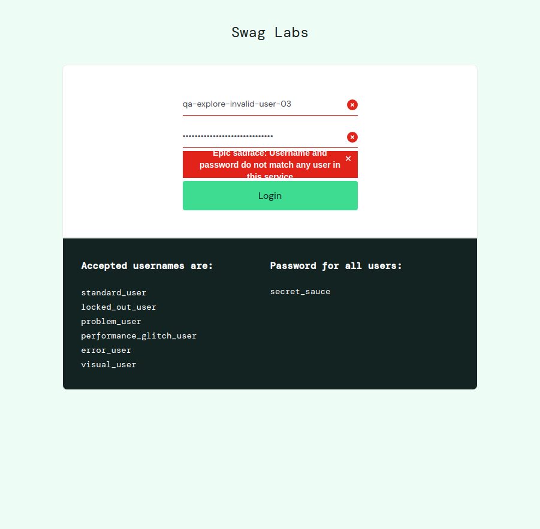

# Agentic QA Skills


---

## Agentic QA Skills Project

This repository packages QA workflows as reusable Agent Skills for AI agents. The skills provide task-specific instructions and references; an agent uses connected tools, while a human reviews and approves the work.

This repository is a fork of [Marina-Gajego/qa-skills](https://github.com/Marina-Gajego/qa-skills). The two skills listed below originate in that project. This fork contributes its own adaptations, documentation, and the Sauce Demo exploratory-session example.

---

## About the QA Skills Framework

An Agent Skill is a folder containing a `SKILL.md` with metadata and instructions, optionally accompanied by references and other resources. Each skill is a focused workflow that can be used independently.

The framework does not include the application being tested. For exploratory testing, provide a target such as a URL or project folder and connect a tool that can interact with it.

---

## Testing Approach

Exploratory testing combines learning, experiment design, interaction, and observation. The `exploratory-testing` skill uses a charter to guide a session, records information and risks, and distinguishes observed defects from questions or unconfirmed behavior.

The `bug-report-writer` skill turns supplied evidence into a reproducible report and marks missing information rather than filling gaps with assumptions. Human review remains part of both workflows.

---

## Technologies Used

- GitHub Copilot
- Playwright MCP for browser interaction
- Agent Skills format

**Copilot skill discovery status:** On 2026-10-26, both `exploratory-testing` and `bug-report-writer` loaded successfully through GitHub Copilot's native Agent Skills discovery from `.github/skills/`. Their physical copies there were verified identical to the corresponding source folders under `skills/` using `diff -qr`. Discovery through the symlinks in `.claude/skills/` was not independently validated, and loading from a completely clean installation has not been tested.

---

## Skills Covered

| Skill | Purpose |
|---|---|
| [`exploratory-testing`](skills/exploratory-testing/SKILL.md) | Conduct an evidence-based exploratory session on a web app, API, mobile or desktop app. |
| [`bug-report-writer`](skills/bug-report-writer/SKILL.md) | Write a clear bug report from supplied findings and evidence without inventing missing details. |

Both skills originate in the upstream QA Skills project. This fork does not claim original authorship of them.

---

## Demonstrated Exploratory Session

The example documents six controlled experiments against the login interface at `https://www.saucedemo.com/`. It covers empty and partially filled forms, whitespace-only entries, whitespace-padded values, and synthetic invalid credentials. No valid credentials were used.

| Experiment | Observed result |
|---|---|
| Empty fields | `Epic sadface: Username is required` |
| Username only | `Epic sadface: Password is required` |
| Password only | `Epic sadface: Username is required` |
| Both fields contain only spaces | `Epic sadface: Username and password do not match any user in this service` |
| Synthetic invalid values with surrounding spaces | The same credentials-do-not-match message; the values remained in the fields. |
| Synthetic invalid values without surrounding spaces | The same credentials-do-not-match message; the values remained in the fields. |

The message for invalid credentials appeared wrapped and partially obscured in the captured view. This is recorded as a **possible visual defect pending confirmation**, not as a confirmed defect; no visual acceptance criteria were available.



The complete session notes and the other four screenshots are available in the [session report](examples/exploratory-testing/saucedemo-login/session.md).

---

## Project Structure

```text
qa-skills/
├── skills/
│   ├── bug-report-writer/
│   │   ├── SKILL.md
│   │   └── references/
│   └── exploratory-testing/
│       ├── SKILL.md
│       └── references/
├── .github/
│   └── skills/                 # Copilot-discovered physical copies of both skills
├── .claude/
│   └── skills/
│       ├── bug-report-writer -> ../../skills/bug-report-writer
│       └── exploratory-testing -> ../../skills/exploratory-testing
├── examples/
│   └── exploratory-testing/
│       └── saucedemo-login/
│           ├── session.md
│           ├── 01-empty-submit.png
│           ├── 02-whitespace-only.png
│           ├── 03-whitespace-padded-invalid.png
│           ├── 04-invalid-credentials.png
│           └── 05-stable-error.png
├── docs/
│   ├── configuration.md
│   └── mcp-and-tools.md
├── .mcp.json
├── .qa-skills.example.yaml
├── CONTRIBUTING.md
└── LICENSE
```

The `skills/` directory contains the upstream skill workflows and their fork adaptations. The `examples/` directory contains the Sauce Demo session and evidence produced in this fork; it is not part of the upstream skill authorship.

For GitHub Copilot, `.github/skills/` contains physical copies of both skills. The copies were verified identical to their corresponding source folders under `skills/` with `diff -qr`.

---

## How to Use the Skills

### Prerequisites

- Git
- GitHub Copilot in a workspace that supports Agent Skills
- Node.js and npm if using the Playwright MCP server configured in this repository

### 1. Get the repository

```bash
git clone https://github.com/pedrogitahy-qa/qa-skills.git
cd qa-skills
```

### 2. Make a skill available to the agent

For a workspace-level skill, copy its folder into the workspace's `.github/skills/` directory:

```bash
mkdir -p .github/skills
cp -R skills/exploratory-testing .github/skills/
```

To use the bug-report workflow as well:

```bash
cp -R skills/bug-report-writer .github/skills/
```

The repository keeps the skill sources under `skills/` and Copilot-ready copies under `.github/skills/`. To install or refresh a copy, repeat the copy commands above. To compare the installed copies with their sources, run:

```bash
diff -qr skills/exploratory-testing .github/skills/exploratory-testing
diff -qr skills/bug-report-writer .github/skills/bug-report-writer
```

Both skills loaded successfully through native Copilot discovery from `.github/skills/` in this repository on 2026-10-26. This does not validate discovery from `.claude/skills/` symlinks or from a completely clean installation.

### 3. Configure browser access for web exploration

The repository's `.mcp.json` contains a Playwright MCP server configuration:

```json
{
  "mcpServers": {
    "playwright": {
      "command": "npx",
      "args": ["-y", "@playwright/mcp@latest"]
    }
  }
}
```

The Playwright MCP connection was verified during a session, but whether GitHub Copilot automatically loaded this `.mcp.json` file—and the exact source of that session's configuration—was not verified. Use the MCP configuration mechanism supported by your agent and approve or start the server as required by that environment. Confirm the connection in the active session before interacting with a target. See [MCP servers and tools](docs/mcp-and-tools.md) for the framework's tool guidance.

### 4. Request a focused session

Give the agent a target, scope, and objective. For example:

> Explore the login interface at `https://www.saucedemo.com/`. Check empty fields, partial input, whitespace, and synthetic invalid credentials. Do not use valid credentials. Ask before executing experiments.

The skill's workflow begins by checking the target and available tools. Provide authorization before any interactions when required. For report language preferences, see [Configuration](docs/configuration.md).

---

## Coverage

The included example covers six exploratory login submissions on Sauce Demo using Playwright MCP. It documents the observed messages, field behavior, unchanged URL, a possible visual issue pending confirmation, and the limits of that session.

This example does not demonstrate valid authentication, post-login workflows, other browsers or devices, API testing, or a confirmed product defect. Mobile and desktop exploration are not demonstrated by this fork.

---

## Agentic QA Approach

- Keep each skill focused on a QA workflow.
- Use tools to interact with the real target and base findings on observed evidence.
- Mark uncertainty, questions, and coverage gaps explicitly.
- Keep a human in the review and approval loop.

---

## Contributing

For skill and documentation contribution guidance, see [CONTRIBUTING.md](CONTRIBUTING.md). Changes specific to this fork should remain clearly distinguished from upstream skill content.

---

## Attribution and License

The original QA Skills framework and skills are by **Marina Gajego**. This fork preserves the upstream MIT license and copyright notice in [LICENSE](LICENSE). Fork-specific adaptations and the Sauce Demo example are contributions in `pedrogitahy-qa/qa-skills`; they do not change the authorship of the original skills.
